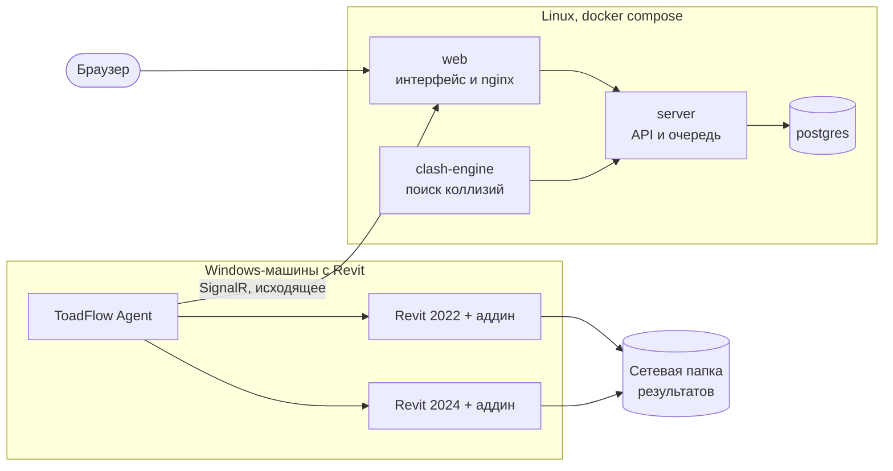

<p align="center">
  
</p>

<h1 align="center">ToadFlow</h1>

<p align="center">
  Ферма Revit, которая по расписанию выгружает модели,<br>
  проверяет заполнение параметров и ищет коллизии. Управляется из браузера.
</p>

<p align="center">
  <a href="https://github.com/Alexpivo394/ToadFlow/releases/latest"></a>
  <a href="https://github.com/Alexpivo394/ToadFlow/actions/workflows/ci.yml"></a>
  <a href="License.md"></a>
</p>

<p align="center">
  <b><a href="#быстрый-старт">Быстрый старт</a></b> ·
  <a href="https://github.com/Alexpivo394/ToadFlow/wiki">Документация</a> ·
  <a href="Changelog.md">Что нового</a>
</p>

---

Выгрузить к утру десятки моделей в NWC, проверить в них параметры и найти пересечения между разделами — работа, ради которой кто-то открывает модели по одной и ждёт. ToadFlow делает её сам: сервер держит расписания, а Windows-машины с Revit и агентом ToadFlow выполняют задания.

## Что он делает

| Модуль | Что получается |
|---|---|
| **Выгрузка RVT / NWC** | Чистые RVT и NWC в сетевой папке, откуда их берут смежники и заказчики. Пресеты те же, что в плагине ToadExporter |
| **Проверка LOI** | Отчёт Excel по каждой модели и аналитика по объектам и разделам: где параметры заполнены, а где нет. Профили те же, что в ParamChecker |
| **Коллизии** | Пересечения между моделями разделов без Navisworks: проверки с матрицей допусков, база коллизий со статусами и историей, отчёты Excel и HTML, рабочие места проектировщиков, панель в Revit через [ToadTools](https://github.com/Alexpivo394/ToadTools) |

Сделано для работы без присмотра:

- **Модель не обновляется.** Она открывается в Revit своей версии, от 2020 до 2027.
- **Несколько Revit на машину**, в том числе разных версий. Сколько именно, задаёт администратор.
- **Зависший Revit не останавливает очередь.** Агент убивает зависший или упавший Revit сам, и модель обрабатывается повторно.
- **Модели откуда угодно:** с Revit Server и из сетевых папок.
- **Всё записано.** У каждой модели пошаговый лог. Видно, кто создал и менял расписание, кто запустил выгрузку и кто убил Revit.
- **Роли:** проектировщик, наблюдатель, координатор, администратор.

## Как это устроено



- **Сервер** хранит расписания, раздаёт задания агентам, собирает логи и хранит слепки моделей для коллизий.
- **Движок коллизий** — отдельный контейнер. Он берёт у сервера прогоны по одному.
- **Агент** сам подключается к серверу, запускает Revit, следит за ним и сообщает о ходе работы. Открывать порты на машинах с Revit не нужно.
- **Аддин** работает только в Revit, который запустил агент. Revit, открытый руками на той же машине, он не трогает.

## Быстрый старт

**1. Сервер.** Linux с Docker, 4 ядра и 8 ГБ памяти.

```bash
git clone https://github.com/Alexpivo394/ToadFlow.git toadflow
cd toadflow/deploy
cp .env.example .env    # POSTGRES_PASSWORD, JWT_KEY, CLASH_ENGINE_KEY, ADMIN_PASSWORD
docker compose up -d --build
```

Интерфейс откроется на `http://<хост>:8080`. Вход — `ADMIN_LOGIN` и `ADMIN_PASSWORD` из `.env`.

**2. Агент.** Windows с Revit. В интерфейсе нажмите **Настройки → Агенты → Подключить агента** и получите код. Затем поставьте `ToadFlowAgent-*.msi` из [релизов](https://github.com/Alexpivo394/ToadFlow/releases/latest):

```powershell
msiexec /i ToadFlowAgent-2.3.3.msi SERVER=http://toadflow:8080 CODE=TF-XXXX-XXXX
```

**3. Первое расписание.** Пользователи, источники моделей, пресеты и расписание — по странице [«Первый запуск»](https://github.com/Alexpivo394/ToadFlow/wiki/Getting-started).

> [!NOTE]
> Обновление с 1.7.1 на 2.0.0 требует копии базы и новой переменной `CLASH_ENGINE_KEY`. Порядок — в вики: [С 1.7.1 на 2.0.0](https://github.com/Alexpivo394/ToadFlow/wiki/Server#с-171-на-200).

## Документация

Вся документация — в [вики](https://github.com/Alexpivo394/ToadFlow/wiki).

| Кому | Страница | Что там |
|---|---|---|
| Администратору | [Установка сервера](https://github.com/Alexpivo394/ToadFlow/wiki/Server) | `.env`, обновление и откат, резервные копии, HTTPS |
| | [Установка агента](https://github.com/Alexpivo394/ToadFlow/wiki/Agent) | Требования к машине, автовход, обновление |
| | [Частые проблемы](https://github.com/Alexpivo394/ToadFlow/wiki/Troubleshooting) | Агент, Revit, модели, LOI, коллизии |
| Координатору | [Первый запуск](https://github.com/Alexpivo394/ToadFlow/wiki/Getting-started) | Пользователи, источники, пресеты, первое расписание |
| | [Расписания](https://github.com/Alexpivo394/ToadFlow/wiki/Schedules) | Какую задачу, над какими моделями, куда и как часто выполнять |
| | [Проверка LOI](https://github.com/Alexpivo394/ToadFlow/wiki/LOI) | Из чего состоит проверка и как настроить её с нуля |
| | [Коллизии](https://github.com/Alexpivo394/ToadFlow/wiki/Clash) | Выгрузка, проверки, статусы, отчёты |
| Проектировщику | [Проектировщику](https://github.com/Alexpivo394/ToadFlow/wiki/Designer) | Работа с коллизиями в браузере и в Revit |
| Разработчику | [Разработка](https://github.com/Alexpivo394/ToadFlow/wiki/Development) | Сборка, тесты, выпуск версии, модули |

## Соседние проекты

ToadFlow собран из ядер, которые живут в своих репозиториях и работают и без него.

| Проект | Зачем он |
|---|---|
| [ToadExport](https://github.com/Alexpivo394/ToadExport) | Ядро выгрузки RVT и NWC |
| [ToadParamCheck](https://github.com/Alexpivo394/ToadParamCheck) | Ядро проверки LOI |
| [ToadClash](https://github.com/Alexpivo394/ToadClash) | Ядро поиска коллизий |
| [ToadTools](https://github.com/Alexpivo394/ToadTools) | Плагины для Revit: ToadExporter, ParamChecker, панель «Коллизии» и другие |

## Лицензия

[MIT](License.md)
