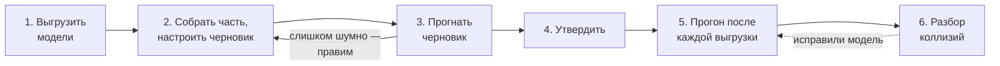
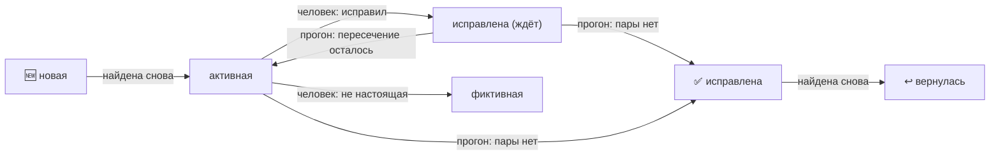

# Коллизии

ToadFlow ищет коллизии между моделями Revit **без Navisworks**. Никаких NWF, никаких «у кого сейчас лицензия Manage?», никаких отчётов в Word на восемьсот страниц, которые никто не открывает.

Как это работает в одном абзаце: агент выгружает из Revit геометрию и параметры элементов, координатор настраивает, что с чем проверять, движок находит пересечения, а проектировщики разбирают **свои** коллизии — в браузере или прямо в Revit. Каждая коллизия получает постоянный номер, статус и историю. Её нельзя «потерять в следующем отчёте».

Работа проектировщика описана отдельно, коротко и без настроек: [Проектировщику](Designer). Эта страница — для координатора.

**На этой странице:** [как устроено](#как-это-устроено) · [выгрузка моделей](#выгрузка-моделей) · [части и черновик](#части-и-черновик) · [прогон](#прогон-черновика) · [3D](#просмотр-в-3d) · [утверждение](#утверждение) · [статусы](#коллизии-и-статусы) · [страница проверки](#страница-проверки) · [отчёт](#отчёт) · [сводка](#сводка) · [обзор проверок](#обзор-проверок)

## Как это устроено

| Шаг | Кто | Где |
|---|---|---|
| 1. Выгрузить модели | расписание выгрузки геометрии для коллизий | **Коллизии → Расписания выгрузки** |
| 2. Собрать модели в часть и настроить черновик проверки | координатор | **Коллизии → Части** |
| 3. Прогнать черновик и посмотреть результат | координатор | вкладка «Черновик» части |
| 4. Утвердить проверку | координатор | «Утвердить…» на вкладке «Черновик» |
| 5. Прогонять утверждённую проверку после каждой выгрузки | расписание | **Коллизии → Расписания выгрузки** |
| 6. Разбирать коллизии | проектировщики, координатор | **Коллизии → Мои**, **Проверки**, панель в Revit |

> [!IMPORTANT]
> **Черновик — песочница.** Его прогоны в базу коллизий ничего не пишут: гоняйте сколько угодно, ломайте, экспериментируйте. Коллизии с номерами, статусами и историей появляются только у **утверждённой** проверки. Пока не нажато «Утвердить», проектировщики не видят ничего — и не получают 40 000 «коллизий» трубы с собственной изоляцией.

## Меню

Пространство **Коллизии** в полосе слева. Рабочие страницы — всем пользователям:

- **Мои** — открытые коллизии разделов пользователя во всех утверждённых проверках;
- **Проверки** — утверждённые проверки по проектам;
- **Сводка** — динамика коллизий по разделам, проектам и проверкам.

Ниже, под разделителем, — настройка проверок, координатору и администратору:

- **Обзор проверок** — что требует внимания;
- **Части** — проекты слева, карточки частей справа: группы, предупреждения о выгрузках, последний прогон, число коллизий;
- **Шаблоны** — сохранённые настройки частей;
- **Выгрузки** — модели проекта с последней выгрузкой и историей выгрузок;
- **Расписания выгрузки** — расписания выгрузки геометрии для коллизий;
- **История** — запуски выгрузок геометрии;
- **Параметры** — хранение слепков и пороги обзора проверок.

Адреса `/clash/...` не меняются никогда: ссылки из отчётов HTML и писем двухлетней давности открываются как раньше.

**Проект** — это объект из [разбора имён моделей](Model-naming); модели без объекта попадают в «Без проекта».

## Права

| Действие | Наблюдатель | Проектировщик | Координатор | Администратор |
|---|:---:|:---:|:---:|:---:|
| Смотреть коллизии, проверки, отчёты, сводку | ✔ | ✔ | ✔ | ✔ |
| Менять статус и «кто правит» | — | в коллизиях своих разделов | ✔ | ✔ |
| Писать примечания | — | в любых коллизиях | ✔ | ✔ |
| Снять «фиктивная», поставленную другим | — | — | ✔ | ✔ |
| Настраивать, прогонять и утверждать проверки | — | — | ✔ | ✔ |
| Хранение и пороги коллизий | — | — | — | ✔ |

## Выгрузка моделей

### Что выгружается

- **Элементы, видимые на 3D-виде**, как при выгрузке NWC. Скрытое на виде в проверку не попадает. Имя вида задаётся в расписании, по умолчанию `Navisworks`.
- По каждому элементу: сетка треугольников в общей системе координат модели, категория, семейство, тип, уровень, рабочий набор, параметры экземпляра и типа, соединения MEP.
- **Опись модели** — все элементы без геометрии. Благодаря описи ToadFlow отличает элемент, который **удалили**, от элемента, который просто **скрыли на виде**. Разница принципиальная: первое — «исправлено», второе — «ушла из-за правил».

Модель открывается с отсоединением, без связей и без обновления; исходный файл не меняется. Каждую модель проекта выгружают отдельно, связи в выгрузку не входят.

### Расписание выгрузки

1. **Коллизии → Расписания выгрузки → «+ Новое расписание»**.
2. Источник и модели — как для выгрузки RVT и NWC. Папка результатов не нужна.
3. Вкладка «Выгрузка для коллизий»: имя 3D-вида и, если нужно, слово в имени рабочих наборов, которые не открывать.
4. «Прогнать утверждённые части после выгрузки» — утверждённые части, которые прогоняются, когда закончатся все задания запуска.
5. Сохраните и нажмите «Запустить сейчас».

Задания выгрузки берут только агенты 2.0.0 и новее; со старыми агентами задания ждут в очереди, редактор расписания об этом предупреждает.

### Как идёт выгрузка

1. Аддин в Revit выгружает элементы вида во временную папку агента `%LocalAppData%\ToadFlow\clash-staging`.
2. Агент **отпускает Revit** и загружает выгрузку на сервер частями со сжатием. Пока файлы едут по сети, Revit уже открывает следующую модель.
3. Сервер проверяет файлы: размер, контрольную сумму, полноту и модель. Полная выгрузка становится **слепком** модели; неполная прошлый слепок не заменяет.
4. В событиях появляется запись «Выгружена модель …» с числом элементов и треугольников.

Загрузка упрямая: после обрыва связи или перезапуска сервера она продолжается с того же места. Если сервер недоступен, выгрузка ждёт повтора — без нового запуска Revit.

| Что случилось | Итог задания |
|---|---|
| В модели нет нужного 3D-вида | ошибка без повтора |
| Сервер отверг выгрузку (файл повреждён, выгрузка неполная) | ошибка с причиной |
| Нет связи с сервером | повтор, пока у расписания есть попытки |

### Хранение

Слепки хранятся на сервере в томе Docker `clash`. У каждой модели остаётся несколько последних слепков, по умолчанию 3; число задаёт администратор в **Коллизии → Параметры**.

Слепки, на которых построен видимый результат черновика, и слепки удачных утверждённых прогонов за последние 14 дней не удаляются: по ним рисуются 3D и картинки.

> [!WARNING]
> Модель опознаётся **по пути**. Модель, перенесённая в другую папку или на другой Revit Server, для ToadFlow — новая модель, с чистой историей. Прежде чем наводить порядок в папках проекта посреди стадии, подумайте дважды.

## Части и черновик

**Часть** — модели, которые проверяются вместе. Обычно это корпус или секция: АР, КР, ОВ, ВК и ЭОМ одного здания.

«+ Новая часть» на странице **Коллизии → Части** открывает мастер:

1. **Модели.** Проект и часть здания по именам моделей; подходящие модели отмечаются сами, раздел правится в строке. Модель другого проекта добавляется поиском.
2. **С чего начать.** По разделам (группа на раздел, набор «Всё», полная матрица 20 мм), из шаблона или копией другой части.

Вкладки части: «Модели», «Наборы», «Матрица», «Исключения», «Черновик».

Правки сохраняются кнопкой «Сохранить», «Отменить правки» возвращает сохранённое. С несохранёнными правками рядом с названием горит «● есть несохранённые изменения», а уход со страницы спрашивает подтверждение.

### Группы, наборы, матрица

Три понятия, на которых стоит вся настройка. Если коротко: **группы** — это «кто», **наборы** — «какие именно элементы», **матрица** — «кого с кем и насколько строго».

- **Группа** — строка и столбец матрицы. Группы разделов создаются сами. «+ Своя группа» — отдельная проверка, например «Проезды» из моделей АР; её наборы отбирают элементы только из её моделей.
- **Набор** — элементы, отобранные условиями. Условие — свойство (категория, семейство, тип, уровень, рабочий набор, параметр), оператор и значение; значения подсказываются из моделей с числом элементов. Условия внутри группы условий объединяются «и», группы условий — «или». Под наборами раздела показано, сколько элементов не попало ни в один набор.
- **Матрица** «группа × группа» — допуск каждой пары групп.
- **Исключения** — пары наборов, которые не проверяются друг с другом, и флажок «Не проверять соединённые элементы MEP».
- **Шаблоны** — меню в шапке части: применить шаблон или сохранить черновик как шаблон. Настроили один корпус идеально — остальные девять получают то же самое за два щелчка.

**Матрица правится кистью.** Выберите «Не проверять», 20, 50, 100 мм или свой допуск и щёлкните клетку — или протяните мышью, как в графическом редакторе. Щелчок по имени группы красит строку или столбец, «Все клетки — 20 мм» перекрывает всю матрицу.

**Допуск** — глубина пересечения в миллиметрах, до которой пересечение коллизией не считается. По умолчанию 20 мм: труба, зашедшая в стену на сантиметр, никого не волнует.

Элемент может входить в несколько групп: проезд — и в «АР», и в «Проезды». Пара таких элементов — одна коллизия; она видна в каждой проверке, где глубина больше допуска клетки.

**Не проверяются никогда:** элемент сам с собой, вложенные семейства одного изделия между собой, изоляция и облицовка против своей трубы или воздуховода. Это избавляет от самого дурацкого класса «коллизий» ещё до того, как вы их увидите.

### Совместная работа

Часть можно настраивать вдвоём и не затирать друг друга:

- в шапке части видно, кто ещё её открыл и на какой вкладке; над набором — кто его сейчас правит;
- сохраняются только изменения: правки разных элементов у двух человек сохраняются обе;
- если оба поменяли одно и то же, второй видит список расхождений и выбирает «Оставить своё» или «Взять чужое»;
- чужое сохранение приходит на страницу само; ваши несохранённые правки остаются.

## Прогон черновика

Вкладка «Черновик» → **«Прогнать»**.

Прогон берёт сохранённый черновик и последние слепки моделей и встаёт в очередь движка. Повторное «Прогнать» заменяет ещё не начатый прогон, начатый можно отменить. У прогона в очереди видны место («В очереди: 2-й») и обычная длительность прогонов этой части — чтобы понимать, чай или обед.

Экран результата:

- **Проверки** — включённые клетки матрицы с числом коллизий и допуском;
- **Коллизии проверки** — по парам наборов, с фильтрами по уровню, модели, категории и глубине;
- **3D** выбранной коллизии.

**С клавиатуры:** ↑/↓ — соседняя коллизия, сквозь страницы и в следующую проверку; Enter — свойства элемента A, ещё раз — B. Выбранные проверка и коллизия хранятся в адресе страницы.

Первый прогон почти всегда выглядит страшно. Это нормально. Дальше начинается настоящая работа координатора: смотрите на пары с тысячами пересечений и решайте — это реальная проблема или шум? Шумную пару можно превратить в исключение прямо из шапки пары наборов, не уходя с экрана. Прогнали, убрали шум, прогнали снова — и так, пока результат не станет списком, который не стыдно показать людям.

### Движок

Движок — отдельный контейнер `clash-engine`, ядра и память задаются в `.env` ([Сервер](Server#переменные-env)). Он связан с сервером только по HTTP общим ключом `CLASH_ENGINE_KEY`, сам скачивает слепки и кеширует их у себя.

- Движок считает **по одному прогону**. Остальные ждут в очереди.
- Если движок молчит 2 минуты, прогон возвращается в очередь; после второй неудачи прогон завершается ошибкой.
- Если прогоны ждут, а движок не обращается к серверу дольше 5 минут, строка прогона и «Обзор проверок» пишут «Движок не отвечает».

## Просмотр в 3D

Прямо в браузере, без установки чего-либо. Сцена показывает элементы **A (красный)** и **B (синий)** и окружение в радиусе 5 м полупрозрачным серым; кадр — по зоне пересечения. Геометрия берётся из тех слепков, на которых шёл прогон.

| Инструмент | Что делает |
|---|---|
| **Всё / Только A и B / Только выбранный** | Изоляция |
| **Окружение** | Радиус от 3 до 20 м |
| **Секущий куб** | Жёлтый контур с ручками на гранях; ручку тянут мышью, «Сбросить куб» возвращает куб вокруг пары. Двойной щелчок по элементу — куб по этому элементу |
| **Свойства** | Щелчок по элементу: категория, семейство, тип, уровень, рабочий набор, ElementId, UniqueId и параметры с поиском |

Вращение — левая кнопка мыши, сдвиг — правая, масштаб — колесо. Нужен браузер с WebGL.

## Утверждение

Черновик настроен, шум убран — пора в бой.

**«Утвердить…»** на вкладке «Черновик» сначала показывает, что изменится в базе коллизий, и только потом делает черновик утверждённой версией с номером (v1, v2…) и комментарием.

Версия хранит конфигурацию, состав моделей и их разделы: правка части до следующего утверждения на прогоны версии не влияет. Можно спокойно экспериментировать в черновике, пока проектировщики работают по v3.

- Флажок «Сразу прогнать утверждённую версию» ставит прогон на последних слепках, не дожидаясь расписания.
- В шапке части — «Утверждена v3 · дата · кто», «Версии» — все версии с комментариями.
- «Сбросить черновик к утверждённой» заменяет черновик действующей версией — когда эксперимент зашёл не туда.

Прогоны утверждённой версии запускает расписание выгрузки (см. [Расписание выгрузки](#расписание-выгрузки)) или координатор на странице проверки.

Модель, которая в этом запуске не выгрузилась, считается непроверенной; модели вне расписания проверяются по последнему слепку.

## Коллизии и статусы

Коллизия — пара элементов (модель, UniqueId) в части. **Номер выдаётся один раз и навсегда**: повторные прогоны, правка наборов и новые версии номер не меняют. «Коллизия №1482» сегодня и через три месяца — одна и та же.

| Статус | Когда |
|---|---|
| **новая** | пара найдена впервые |
| **активная** | найдена снова |
| **вернулась** | была исправлена и найдена снова |
| **исправлена (ждёт)** | человек отметил исправление; следующий прогон подтвердит его или вернёт коллизию в «активную» |
| **исправлена** | пары больше нет: элементы раздвинули, удалили или убрали из наборов |
| **ушла из-за правил** | пару отсекла новая версия проверки или элемент скрыт на виде выгрузки |
| **не проверена** | модель элемента в этом цикле не выгрузилась |
| **фиктивная** | человек отметил, что коллизия не настоящая, с примечанием; прогоны её не меняют |

Обратите внимание: «исправлена» ставит **не человек, а прогон**. Человек может только сказать «я исправил» — а движок на следующую ночь проверит. Доверяй, но проверяй, как говорится.

**Открытые** — новая, активная, вернулась, исправлена (ждёт) и не проверена. Этот набор статусов используется во всех списках, счётчиках и сводке.

Повторный прогон той же версии не пересчитывает пары, у которых не изменились геометрия обоих элементов, наборы и соединения, — поэтому ночные прогоны быстрее первого. После новой версии всё считается заново.

### Пересозданный элемент

Проектировщик удалил воздуховод и нарисовал такой же заново. Для Revit это новый элемент с новым UniqueId, а значит, его пара становится **новой коллизией** — с подсказкой «Возможно, это коллизия №N».

«Объединить» переносит пару в прежнюю коллизию: остаются её номер, статус и лента, новая удаляется.

- Объединить можно только с коллизией, которую последний прогон не нашёл.
- Автоматически коллизии не объединяются: «похоже на ту же самую» — решение для человека.

## Страница проверки

**Коллизии → Проверки → проверка.** Главное рабочее место координатора.

Сверху — последний прогон: версия, состояние и итог (найдено, новых, вернулось, исправлено, ушло из-за правил, не проверено). «Отчёт» открывает [отчёт прогона](#отчёт), «Все прогоны» — список прогонов.

Ниже — список коллизий, справа 3D и карточка выбранной коллизии.

- **Фильтры:** статус (по умолчанию открытые), пара разделов, уровень, кто правит, поиск по номеру, ElementId или UniqueId; сортировка по глубине, номеру или уровню; группировка по элементу.
- **Карточка:** статус, «Кто правит» (раздел стороны, если разделы сторон разные, иначе «сторона A / B»), кнопки «Беру», «Передать…», «Исправлена (ожидает подтверждения)», «Фиктивная…», «Снять „фиктивная“» и примечание.
- **Лента:** примечания, смены статуса и «кто правит», версия, которой найдена коллизия, и глубина по прогонам. Вся биография коллизии в одном месте.

↑/↓ — соседняя коллизия; выбранная коллизия хранится в адресе. Кнопки Excel и HTML выгружают список с текущими фильтрами.

> [!TIP]
> **Группировка по элементу** — спасение, когда одна балка пересекается с тридцатью трубами. Это не тридцать проблем, а одна: балка не там. Группировка это показывает.

### Массовые действия

Флажки в строках или «Выделить все по фильтру» выделяют коллизии; панель внизу применяет к ним «Беру», «Кто правит», «Исправлены», «Фиктивные», «Примечание» и «Отметить просмотренными».

Действие над всеми по фильтру спрашивает подтверждение с числом коллизий — чтобы «отметить фиктивными 3 400 коллизий» было осознанным решением. Коллизии, которые пользователю менять нельзя, пропускаются; итог называет изменённые и пропущенные с причиной.

## Мои

**Коллизии → Мои** — открытые коллизии всех утверждённых проверок, где хотя бы один элемент из модели разделов пользователя. Разделы пользователь выбирает при регистрации, а меняет координатор в **Администрирование → Пользователи**.

Строки идут под заголовками «проект · проверка». Счётчики над списком — переключатели «Мне править», «Другая сторона» и «Новые для меня». Синяя точка отмечает коллизию, которую пользователь ещё не открывал; точка гаснет, когда открыта карточка.

Как с этим работать проектировщику — [Проектировщику](Designer).

## API плагина «Коллизии»

Панель «Коллизии» в Revit (ToadTools) берёт коллизии открытой модели одним запросом: `GET /api/clash/models/{key}/collisions`. Это коллизии модели по всем утверждённым частям; «своя» сторона определяется моделью, а не разделами пользователя.

| Параметр | Что делает |
|---|---|
| `status`, `group`, `pair`, `level`, `q`, `since` | Статус, «мне править» или «другая сторона», пара разделов, уровень, поиск по номеру или идентификатору элемента, только новые для пользователя |
| `part` | Идентификатор части проекта (корпуса), например `3f2b8c1e-5a47-4d0e-9b1c-7a6d2e4f8a90`. Остаются коллизии только этой части, счётчики и фасеты пар, уровней и статусов считаются по ней же. Если части нет среди утверждённых, страница пуста, ошибки нет |

В ответе `facets` перечисляет пары, уровни, статусы и части: `[{ "value", "label", "count" }]`. Каждый фасет считается с остальными фильтрами, но без своего: поэтому выбор корпуса не прячет другие корпуса. В `facets.parts` попадают части, где у модели есть коллизии; из-за фильтров счётчик части может стать нулём. Без `part` запрос работает как прежде, поле `facets.parts` добавлено к ответу.

## Отчёт

Отчёт прогона: слева дерево «Сводка → раздел → пары разделов», справа сводка или список коллизий по уровням. Разделы и пары идут в порядке справочника разделов из [разбора имён моделей](Model-naming).

| Выгрузка | Что внутри |
|---|---|
| Excel | строки выбранного среза |
| HTML пары | картинки у первых 1000 строк, остальные строки таблицей; фильтры по статусу, уровню и тексту работают в файле без сервера; размер файла виден до скачивания |
| Архив раздела или проверки | `.zip` с HTML на каждую пару; готовится в фоне и хранится сутки |

HTML-отчёт — самодостаточный файл: его можно отправить подрядчику, у которого нет доступа к ToadFlow, и фильтры у него всё равно будут работать.

«Скопировать сообщение для чата» — короткий итог прогона со ссылкой на отчёт. Для тех, кто каждое утро пишет в чат проекта одно и то же.

## Сводка

**Коллизии → Сводка** — открытые коллизии и их рост за неделю, месяц или свой период по разделам, проектам, проверкам или парам. Страница для вопроса «мы вообще движемся или стоим?».

- **Кто отстаёт** — у кого больше всего открытых и висящих коллизий; строка открывает список этих коллизий.
- **На ком коллизии** — сколько коллизий раздел правит сам и сколько ещё не поделено между разделами.

## Обзор проверок

**Коллизии → Обзор проверок** — список проблем со ссылками туда, где их решают:

- модель не выгрузилась или слепок устарел;
- прогон не прошёл или давно не шёл, модели не проверены;
- всплеск новых коллизий, висящие коллизии;
- утверждённая проверка без расписания, агенты не в сети, движок не отвечает.

Пороги «устарел», «всплеск» и «висит» задаёт администратор в **Коллизии → Параметры** — см. [Хранение и пороги коллизий](Settings#хранение-и-пороги-коллизий).

Если проблем нет, обзор пишет «Всё в порядке». Редкое, но приятное зрелище.
