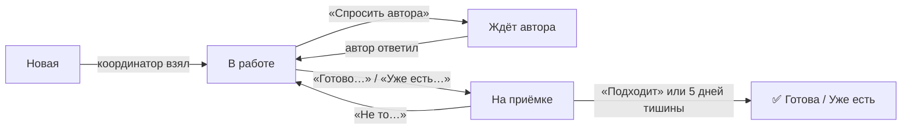

# Семейства

У каждой компании есть сетевая папка с семействами. И у каждой она выглядит одинаково: `Клапан.rfa`, `Клапан_новый.rfa`, `Клапан_новый_ИСПРАВЛ.rfa`, `Клапан (Петров).rfa` и папка `!!!НЕ ТРОГАТЬ`. Какой из клапанов правильный, знает один человек, и он в отпуске.

Модуль «Семейства» (`families`) превращает эту папку в **каталог**: с поиском, картинками, версиями и понятным ответом на вопрос «какое брать».

Как это выглядит в жизни:

- **Координатор** кладёт файл `.rfa` в папку. Через интервал обхода семейство появляется в каталоге с версией Revit, а когда ферма его прочитает — с картинкой, категорией, типоразмерами и параметрами. Вводить руками ничего не нужно.
- **Проектировщик** ищет и загружает семейства из панели «Семейства» в Revit (плагин ToadTools), а если нужного нет — подаёт заявку.

> [!IMPORTANT]
> **Папка — главная.** Файлы лежат только в ней: сервер их не хранит и не видит. Если сервер ToadFlow выключить, семейства по-прежнему берутся проводником, как двадцать лет до этого. ToadFlow — это каталог *поверх* папки, а не замок на ней.

**На этой странице:** [папка библиотеки](#как-устроена-папка-библиотеки) · [что система делает сама](#что-система-делает-сама) · [состояния](#состояния) · [как утвердить](#как-утвердить) · [«Нужно решение»](#нужно-решение) · [панель в Revit](#панель-семейства-в-revit) · [заявки](#заявки) · [каталог](#каталог) · [для администратора](#для-администратора)

## Как устроена папка библиотеки

```
\\server\Families\            корень библиотеки
  ОВ\Клапаны\Клапан.rfa        раздел карточки — первая папка под корнем («ОВ»)
  ОВ\Клапаны\Клапан.txt        каталог типоразмеров — часть семейства
  _На проверке\…               папка проверки: всё в ней — «на проверке»
  _Итерации\Дверь\ЖК Полковая\Дверь.rfa   итерация «ЖК Полковая» семейства «Дверь»
  .toadflow\history\…          копии всех версий, их пишет агент библиотеки
```

Пять правил папки:

- **Структуру подпапок ведут координаторы.** Сама система в библиотеке ничего не перекладывает, не переименовывает и не удаляет — только по кнопке координатора в вебе (см. [Как утвердить](#как-утвердить)). Без кнопок она пишет только в `.toadflow`.
- **Имя файла уникально на всю библиотеку.** Revit различает семейства в проекте по имени, а имя семейства — это имя файла. Второй файл с занятым именем в каталог не попадает и уходит в «Нужно решение». Два разных `Клапан.rfa` в разных папках — это не «у нас так сложилось», это бомба замедленного действия.
- **Каталог типоразмеров** — файл `.txt` с тем же именем рядом с `.rfa`. Кодировки Windows-1251, UTF-8 и UTF-16 читаются одинаково.
- **В каталог не попадают** резервные копии Revit (`Имя.0001.rfa`), всё внутри `.toadflow` и файлы не `.rfa`.
- **Семейства делаются и хранятся в Revit 2022.** Файл, сохранённый в 2024, в каталоге помечен своей версией: в проекте Revit 2022 он не загрузится.

## Что система делает сама

Агент библиотеки раз в интервал (по умолчанию 10 минут) **обходит папку без Revit**: перечисляет файлы, считает хеш (SHA-256) новых и изменившихся и сразу копирует новое содержимое в `.toadflow\history\<хеш>.rfa` (и `.txt`). Когда файл потом перезапишут, прежнее содержимое уже сохранено. Потерять версию семейства отныне сложно, даже если очень стараться.

**Файл берётся, только когда он дописан**: размер и время записи не менялись с прошлого обхода и файл никто не держит открытым на запись. Файл, который ещё копируется или открыт в Revit, ждёт следующего обхода, а его карточка остаётся как была.

По отчёту обхода сервер, как следователь, решает, что случилось с каждым файлом:

| Что видно | Что это |
|---|---|
| Новый путь, такого содержимого и имени нет ни у одной карточки | **Новое семейство**: появляется карточка |
| Тот же путь, другое содержимое `.rfa` | **Новая версия** карточки; вне папки проверки — с пометкой «изменено без проверки» |
| Изменился только `.txt` | Новая версия с пометкой «изменён каталог типоразмеров» |
| То же содержимое, другой путь, прежнего файла больше нет | Файл **переехал или переименован**: карточка та же, история цела |
| Файл в папке проверки с именем утверждённой карточки | **Версия-кандидат** этой карточки |
| Имя занято другой карточкой, содержимое другое | **Конфликт имён**: в каталог не попадает, уходит в «Нужно решение» |
| То же содержимое, что у другой карточки, чей файл на месте | **Дубль**: второй карточки нет, уходит в «Нужно решение» |
| Один файл исчез, другой появился с новым содержимым | **Неясно**, перенос с правкой это или два разных события: «Нужно решение», карточка в архив не уходит |
| Файл исчез | Карточка уходит в **архив** |

> [!NOTE]
> **В архив — только после полного обхода.** Если хоть одна папка не прочиталась или какой-то новый файл ещё дописывается, ни одна карточка в архив не уходит. Отвалившийся на минуту сетевой диск не превратит всю библиотеку в архив.

На каждое новое содержимое сервер ставит задание ферме: аддин открывает файл в Revit той версии, в которой файл сохранён (нет такой — в ближайшей старшей), читает категорию, способ размещения, типоразмеры (из файла и из `.txt`), параметры и снимает картинку. Файл при этом не сохраняется и не меняется. Задания видны в **Ферма → Очередь и журнал**.

## Состояния

| Состояние | Когда | Кто видит в каталоге |
|---|---|---|
| **Утверждено** | Файл в библиотеке вне папки проверки | Все |
| **На проверке** | Файл в папке проверки | Координаторы и наблюдатели; проектировщик — только с флажком «Показывать непроверенные» |
| **Архив** | Файл убран из библиотеки | Координаторы и наблюдатели, фильтром «Состояние» |

Состояние определяется просто: **где лежит файл**. Никаких скрытых флажков в базе — положение в папке и есть правда.

Состояние есть и у версии. У утверждённой карточки может быть **версия-кандидат** — файл с тем же именем в папке проверки. Пока её не утвердили, проектировщик получает прежнюю версию. Можно спокойно дорабатывать семейство, не ломая никому проект.

## Как утвердить

Есть два способа, и оба правильные.

### Кнопками в вебе

Координатор жмёт кнопку — файл перекладывает агент библиотеки, и сразу начинается обход.

| Что | Где | Что происходит |
|---|---|---|
| Утвердить новое семейство | «На проверке» → «Утвердить и переложить в…», или карточка | Файл (с каталогом `.txt`) переезжает в выбранную папку библиотеки; карточка та же, становится «утверждено» |
| Утвердить новую версию | «На проверке» → «Утвердить», или «Версии» карточки | Кандидат ложится на место действующего файла; прежний остаётся в истории |
| Отклонить | «На проверке» или «Версии» карточки → «Отклонить…» с причиной | Файл уходит из папки проверки; версия в истории помечена «отклонено: причина» |
| Убрать в архив | Карточка → «В архив» | Файл уходит из библиотеки, карточка — в архив |
| Вернуть из архива | Архивная карточка → «Вернуть из архива» | Файл возвращается из истории на прежнее место; карточка та же, с историей |
| Вернуть прошлую версию | «Версии» карточки → «Вернуть эту» | Содержимое прошлой версии ложится на место файла; новая версия помечена «возврат к версии от …» |

Две страховки, которые работают всегда:

- Перед любым действием агент проверяет, что на месте **ровно тот файл**, который видел сервер. Если файл успели поменять, действие не выполняется, и веб говорит почему.
- Всё, что убирается или перезаписывается, сначала сохраняется в `.toadflow\history`.

Кнопки неактивны, пока агент библиотеки не в сети или старой версии: подсказка на кнопке говорит, в чём дело.

### Проводником

Как раньше — система поймёт:

- переложите файл из папки проверки на место → новое семейство утверждено;
- положите кандидата поверх действующего файла → новая версия;
- удалите файл из папки проверки → отклонено.

Система видит это при следующем обходе; **Параметры → Обойти сейчас** запускает обход сразу.

**А если перезаписать утверждённый файл прямо на месте?** Тоже можно. Такая версия сразу действует, в истории помечена «изменено без проверки» и показана в «Нужно решение», чтобы её посмотрели. Координатор может дописать к ней описание и указать себя автором: «Версии» карточки → «Описание…». Система не запрещает срезать угол — она просто не делает вид, что ничего не было.

## «Нужно решение»

Страница для случаев, которые система честно не берётся решать сама. Их семь:

| Случай | Кнопкой | Проводником | Когда закрывается сам |
|---|---|---|---|
| **Конфликт имён** | «Переименовать…» (новое имя файла) или «Удалить файл» | Переименовать один из файлов или удалить лишний | После полного обхода без конфликта |
| **Дубль** | «Удалить копию» или «Оставить» — тогда этот случай больше не спрашивается | Удалить лишнюю копию | После полного обхода без дубля |
| **Неясно: перенос или новое** | «Новая версия того» — файл становится версией прежней карточки; «Другое семейство» — прежняя карточка уходит в архив, у файла своя | Положить файл на место прежнего под прежним именем | Когда причина ушла |
| **Не читается** | «Прочитать снова» — файл снова уходит ферме | Исправленный файл положить на место | Когда ферма прочитает файл |
| **Изменено без проверки** | «Посмотрел» | — | — |
| **Итерация не по шаблону** | — | Переложить файл в папку итерации и назвать как семейство (см. [Итерации](#итерации--проектные-варианты)) | После полного обхода без такого файла |
| **Изменено после финала** | «Посмотрел» | — | — |

В идеальном мире эта страница пуста. В реальном — загляните сюда раз в неделю.

## Итерации — проектные варианты

У архитекторов дверь одна на всех — пока не начинается проект. Под каждый проект, а то и под каждую модель, в неё вносят мелкие правки, и через полгода в двух моделях стоят две разные «Дверь_ДГ», которые уже не взаимозаменяемы. Делать из каждой правки новое семейство с новым именем — значит снова плодить россыпь; править общее — значит ломать чужие проекты. Итерации — третий путь.

**Итерация** — проектный вариант семейства со своим названием, комментарием и своей историей версий. У семейства есть «Основная» (тот же файл, что и раньше, с проверкой) и сколько угодно итераций. Правка итерации не трогает ни «Основную», ни другие итерации.

```
_Итерации\Дверь_ДГ\ЖК Полковая\Дверь_ДГ.rfa      итерация «ЖК Полковая»
_Итерации\Дверь_ДГ\Дом на Набережной\Дверь_ДГ.rfa
```

- Файл итерации лежит в папке итераций (по умолчанию `_Итерации`, задаётся в «Параметрах») по шаблону `<папка итераций>\<семейство>\<итерация>\<семейство>.rfa`. Имя папки итерации — её название. Имя файла — как у семейства: в проекте это то же семейство.
- Правило «имя уникально на всю библиотеку» на папку итераций не распространяется: одинаковые имена там — норма, в одной модели всё равно стоит одна итерация. Итерация, только что сделанная из «Основной», с тем же содержимым — тоже не дубль.
- Итерации публикуются **сразу**, без папки проверки: это проектная правка, а не новый стандарт.
- Файл, положенный в папку итераций не по шаблону (или от семейства, которого в библиотеке нет), в каталог не попадает и уходит в «Нужно решение».

**Как сделать итерацию.** В карточке семейства → вкладка «Итерации» → «Новая итерация»: название, от какой версии (любая версия любой итерации), комментарий. Файл кладёт агент библиотеки, версия появляется после обхода. Или из Revit: «Опубликовать → В итерацию существующего → Новая итерация…». Или проводником — положить файл по шаблону.

**Как менять.** Любую итерацию, а не только последнюю: публикацией из Revit («В итерацию существующего» → выбрать итерацию), проводником (перезаписать её файл) или кнопкой «Вернуть» у прошлой версии. У каждой версии — свой комментарий, его можно дописать или поправить у любой версии («Описание…»). Переименовать итерацию — переименовать её папку проводником: история не теряется.

**Финал.** Проект сдан — его дверь больше не меняют и в новые проекты не грузят, но иногда в неё надо заглянуть. «Финальная версия…» (в карточке или галочкой при публикации) с обязательным комментарием «что проделано» завершает итерацию: панель Revit её не предлагает (только с флажком «завершённые» и с вопросом перед загрузкой), публиковать в неё нельзя. Если файл завершённой итерации всё-таки перезаписали проводником, это всплывёт в «Нужно решение». «Снять финал» возвращает итерацию в работу.

**Убрать.** «Убрать» удаляет файл итерации из папки; история остаётся, «Вернуть» кладёт его обратно.

**В проекте** на семействе отмечено, из какой итерации оно загружено: вкладка «В проекте» сравнивает его со своей итерацией, а «Обновить выбранные» берёт новую версию той же итерации — вариант одной модели не подменит вариант другой.

## Только координаторы и без оповещений

Два флажка в карточке семейства (координатор):

- **Только координаторы** — проектировщик видит семейство с замком, но загрузить его из панели не может; путь к файлу ему не показывается. Такой же флажок есть у каждой итерации — например, когда итерация ещё сырая.
- **Без оповещений** — тем, кто загружал семейство, не приходит «Обновлено». Для разовой мелкой правки есть галочка «Без оповещения» при публикации из Revit. Координаторам «На проверку» приходит в любом случае.

«Обновлено» теперь адресное: по «Основной» — тем, кто загружал «Основную», по итерации — тем, кто загружал эту итерацию.

## Панель «Семейства» в Revit

Кнопка **ToadTools → Общие → Семейства** показывает и скрывает закрепляемую панель. Панель работает под тем же входом в ToadFlow, что и «Коллизии». Нужен ToadTools 4.4.0 или новее.

**Поиск.** Та же строка и те же фильтры, что в вебе. Флажок «непроверенные» показывает и семейства на проверке, с пометкой.

**Карточка.** Картинка, типоразмеры с галочками, кто и когда обновил, история версий с комментариями. Если у семейства есть итерации, сверху выбор «Вариант»: «Основная» или итерация — типоразмеры, картинка, путь и история меняются под выбранную (ToadTools 4.7.0). «Загрузить» берёт файл из папки библиотеки, сверяет его хеш с карточкой и загружает отмеченные типоразмеры. Если файл только что поменяли, панель предупреждает и даёт загрузить то, что лежит в папке.

Что стоит знать о загрузке:

- Семейство, сохранённое в Revit новее запущенного, видно, но не загружается: «только для Revit 2024 и новее».
- Если семейство с таким именем уже есть в проекте, загрузка его **заменяет**: значения параметров типа берутся из библиотеки, значения размещённых экземпляров сохраняются, вложенные общие семейства берутся из файла.
- На загруженное семейство ставится **метка**: из какой карточки и какой версии. Файл `.rfa` не меняется.
- Каждая загрузка учитывается: на карточке видно, сколько раз её загружали; при равном соответствии поиска такие семейства выше. Популярное всплывает само.

**В проекте.** Семейства открытой модели с вердиктом: «актуально», «устарело», «не из библиотеки» (если в библиотеке есть семейство с тем же именем — оно предложено), «убрано в архив». «Обновить выбранные» кладёт действующую версию поверх, с теми же типоразмерами, что уже есть в проекте. Вопрос «а у нас в проекте старые семейства?» наконец получает ответ за один щелчок.

**Опубликовать** (координатор, в редакторе семейств). Новое семейство — в папку проверки (или в другую папку библиотеки, она выбирается из списка), новая версия существующего — в папку проверки под его именем, итерация — в её папку сразу. В библиотеку уходит копия файла вместе с каталогом `.txt`, открытый документ остаётся вашим файлом. Можно написать, что изменилось, и указать заявку, которую публикация закрывает. Занятое другим семейством имя панель не принимает. Из Revit новее 2022 панель предупреждает, что проекты в Revit 2022 семейство не получат.

**«Нет нужного»** (ToadTools 4.5.0). Открывает форму заявки в браузере: текст поиска, проект, раздел и версия Revit уже заполнены. Над поиском — отметки о ваших заявках: «готово» открывает найденное семейство, у заявки на приёмке — «Подходит» и «Не то…» (откроет заявку в браузере). У карточки — «Сообщить о проблеме».

## Заявки

**Семейства → Заявки.** Раньше это выглядело так: проектировщик пишет в чат «нужен клапан», сообщение уезжает вверх, через неделю он пишет снова, а координатор отвечает «какой клапан?». Заявки — это то же самое, только ничего не теряется.

Подают проектировщики, координаторы и администраторы; наблюдатель только смотрит.

### Подать

Единственное обязательное поле — **«Что нужно»**. Всё остальное помогает координатору, но подать можно и без него: лучше короткая заявка, чем никакой.

- **Покажите, что нужно.** Вставьте скриншот Ctrl+V (из Revit, PDF-каталога, сайта производителя), перетащите файлы или выберите их. Миниатюры видны сразу, до подачи. До 25 МБ на файл, до 30 файлов на заявку. Один скриншот из каталога заменяет три абзаца описания.
- **Подробности.** Подсказка в поле зависит от направления: что обычно нужно знать (DN и присоединение для ОВ/ВК, сечение и материал для КР). Ссылки в тексте кликабельны.
- **Направление, раздел, проект, версия Revit, нужно к, блокирует выдачу.** Проект подсказывается из уже введённых.
- Над кнопкой видно, кому уйдёт заявка: «ОВ/ВК — Петров, Сидоров».

> [!NOTE]
> **«Блокирует выдачу»** — значит, без семейства не выпустить документацию. Такие заявки первыми в очереди. Галочка честная: если ставить её на всё подряд, она перестанет что-либо значить — как слово «срочно» в рабочем чате.

**Справа — «Может, уже есть».** Пока вы пишете, показываются похожие семейства каталога и открытые заявки. К похожей заявке лучше присоединиться кнопкой **«Мне тоже нужно»**: пять голосов за одну заявку весят больше, чем пять одинаковых заявок.

**Проблема в семействе каталога** — кнопка «Сообщить о проблеме» в карточке семейства (в вебе и в панели). Такая заявка привязана к семейству; в карточке видно «Известные проблемы».

### Как идёт заявка



| Состояние | Что значит | Чей ход |
|---|---|---|
| **Новая** | никто не взял | координатора |
| **В работе** | есть исполнитель | исполнителя |
| **Ждёт автора** | исполнитель задал вопрос | автора |
| **На приёмке** | сделано или найдено подходящее | автора |
| **Готова / Уже есть** | автор принял | — |
| **Отклонена / Отозвана** | с причиной / автор передумал | — |

У заявки всегда понятно, **чей ход**. Она не может «повиснуть где-то».

- **Координатор** берёт заявку («Обещаю к» — срок, к которому сделает), передаёт другому или в другое направление, задаёт вопрос кнопкой **«Спросить автора»** — ход переходит к автору. Ответ автора в переписке (или просто вложение) возвращает заявку в работу.
- **«Готово…» / «Уже есть…»** с выбором семейства отправляют заявку автору на приёмку. Публикация из панели с указанной заявкой делает то же, когда обход увидит файл.
- **Автор** жмёт **«Подходит»** или **«Не то…»** с объяснением — тогда заявка возвращается тому же исполнителю.
- **Если автор молчит**, заявка принимается сама через 5 дней (настраивается: **Семейства → Параметры → «Автоприёмка, дней»**); за сутки до этого приходит напоминание. Молчание — знак согласия.
- Автор может изменить описание или отозвать заявку, пока она открыта.

### Очередь координатора

Вкладки: **Моё направление** (по умолчанию: заявки направлений, где вы координатор, и общая очередь), **Мне назначено**, **Без исполнителя**, **Ждут автора**, **На приёмке**, **Все**.

Сверху — цифры, и каждая работает как фильтр: в направлении, открыто, без исполнителя, просрочено, сколько в среднем до приёмки.

Порядок в очереди:

1. блокирующие выдачу;
2. по сроку — просроченные первыми, красным;
3. где больше ждущих («Мне тоже нужно»);
4. старшие.

### Направления BIM

**Семейства → Параметры → Направления BIM** (меняет администратор). Чтобы заявка на клапан не падала конструкторам.

У направления — название («ОВ/ВК»), разделы библиотеки, разделы моделей, координаторы и подсказка для заявки.

Куда идёт заявка — первое, что сработало:

1. явно выбранное направление;
2. по разделу библиотеки;
3. по разделам профиля автора, если они дают ровно одно направление;
4. в общую очередь.

Уведомление о новой заявке получают координаторы направления; если направления нет или в нём никого — все координаторы. Разделы библиотеки вне направлений подсвечены в настройке, чтобы вы видели дыры.

### Искали и не нашли, аналитика

Два экрана, которые превращают жалобы в план работ.

- **Семейства → Не нашли** (координатору): что искали в каталоге и панели Revit и не нашли за 30 дней — сколько раз и сколько людей. Набор по буквам список не засоряет. По запросу без заявки — кнопка «Создать заявку». Если двенадцать человек за месяц искали «лючок ревизионный» — это не двенадцать недовольных, это готовая задача.
- **Семейства → Аналитика**: заявки по неделям; по направлениям — открыто, просрочено, медиана до приёмки, доля «Не то»; нагрузка исполнителей; востребованные семейства и семейства без загрузок за 180 дней. «Скачать Excel» — то же файлом.

## Каталог

**Одна строка поиска — и она умная.** Ищет по имени, пути, категории, производителю, описанию, меткам, именам типоразмеров и параметров и по значениям параметров типоразмеров.

- Слова ищутся **по части**: «клаб-40» находит типоразмер «КЛАБ-40-20».
- Подходит карточка, в которой есть **все** слова запроса.
- Карточки, где слова входят в имя, — выше.

Фильтры: раздел, категория, версия Revit, размещение; координатору — состояние. Поиск, фильтры и открытая карточка сохраняются в адресе страницы — ссылку можно переслать: «вот этот бери».

Карточка показывает картинку, полный путь с кнопкой «Скопировать путь», типоразмеры, параметры и версии; известные проблемы и проекты, куда семейство загружали. Из веба семейство не скачивается: файл берётся из папки.

Координатор дописывает к карточке описание, метки и производителя — они тоже ищутся. Пять минут на метки сегодня — минус десять вопросов «а как оно называется?» завтра.

## Для администратора

**Семейства → Параметры:**

| Поле | Что это |
|---|---|
| Корень библиотеки | Путь UNC (`\\сервер\папка`) или с буквой диска, как его видит агент библиотеки |
| Папка проверки | Имя папки в корне, по умолчанию `_На проверке` |
| Обходить раз в | Интервал обхода, 1–1440 минут |
| Агент библиотеки | Машина фермы, которая обходит папку; «любой в сети» — первый агент новой версии, который это умеет |

Пока корень библиотеки не задан, модуль ничего не делает — на «Обзоре» плитка «папка не задана».

Блок **«Состояние библиотеки»** показывает агента, последний обход, полный ли он, ошибки обхода и сколько файлов ждут чтения. На «Обзоре» появляется строка «библиотека недоступна», если полного обхода нет дольше трёх интервалов, и «нет агента для обхода библиотеки», если подходящего агента нет в сети.

### Права на папку

Агент работает от имени пользователя, вошедшего на машину фермы (см. [Агент](Agent)).

| Кто | Права | Зачем |
|---|---|---|
| Учётные записи всех машин фермы с Revit | Чтение всей библиотеки | Задания чтения выполняет любая машина |
| Учётная запись агента библиотеки | Запись во всю библиотеку | Копии версий в `.toadflow` и кнопки веба (утвердить, отклонить, архив, возврат) |
| Проектировщики | Чтение | Загружать семейства |
| Координаторы | Запись | Публикация из панели Revit сохраняет файл в библиотеку |

> [!NOTE]
> Если у агента библиотеки есть запись только в `.toadflow`, обход работает, а кнопки веба отвечают «нет доступа». Симптом узнаваемый: каталог обновляется, а «Утвердить» не утверждает.

Папку `.toadflow` агент создаёт сам и делает скрытой; проектировщикам её лучше закрыть совсем — делать им там нечего.

Вложения заявок и картинки семейств сервер хранит в томе `families` (`Families__StorageRoot`). nginx пропускает файлы заявок до 26 МБ.

### Агенты

Обход, действия с файлами и чтение семейств умеют агенты 3.0 и новее. Агенты прошлых версий продолжают выполнять выгрузку, LOI и коллизии: сервер не просит их обходить библиотеку, не даёт им задания чтения, а кнопки веба говорят, что агент библиотеки старой версии.

Кеш хешей агент держит в `%ProgramData%\ToadFlow\Agent\families`. Если назначить агентом библиотеки другую машину, её первый обход пересчитает хеши всех файлов — это займёт дольше обычного, но ничего не меняет в каталоге.
