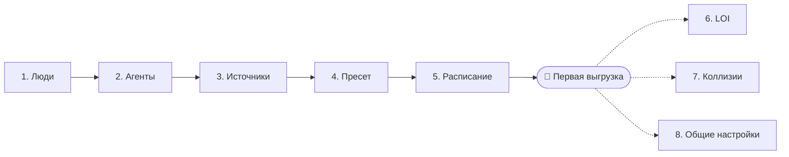

# Первый запуск

Сервер поднят ([Установка сервера](Server)), вы вошли администратором и смотрите на девственно пустой «Обзор». Отлично. Через восемь шагов здесь будет жизнь.

Идём по порядку — каждый следующий шаг опирается на предыдущий. На всё про всё уйдёт час, из которых сорок минут вы будете ждать, пока Revit откроет первую модель.

## 1. Пользователи

**Администрирование → Пользователи → Новый пользователь.**

Заведите коллег под их настоящими именами, а не «user1» и «bim». Имя видно в истории: кто создал расписание, кто его менял, кто запустил выгрузку и кто убил Revit. Через полгода, когда вы будете выяснять, кто выключил ночную выгрузку, вы скажете себе спасибо.

| Роль | Что может |
|---|---|
| **Проектировщик** | Свои коллизии, отчёты и сводка; каталог семейств и заявки; аналитика LOI (только смотреть). Регистрируется сам, заявку подтверждает координатор |
| **Наблюдатель** | Смотрит «Обзор», модули, Ферму и коллизии; ничего не меняет. Идеальная роль для руководителя |
| **Координатор** | Плюс расписания, пресеты и профили LOI, запуск, отмена и повтор заданий, «Убить» Revit, настройка и утверждение проверок коллизий, заявки на регистрацию |
| **Администратор** | Плюс агенты, источники, пользователи и общие настройки |

Подробно — [Где что настраивается → Пользователи](Settings#пользователи).

## 2. Агенты

**Ферма → Агенты → Подключить агента** — сервер выдаст одноразовый код. С ним ставите агента на машину с Revit: [Установка агента](Agent).

Подключённый агент сам доложит, какие версии Revit у него нашлись. Кнопкой **«Изменить»** задайте, сколько Revit каждой версии он держит одновременно.

> [!TIP]
> Жёсткого потолка на число Revit нет, но у памяти он есть. Тяжёлая модель съедает 10–20 ГБ. Три таких модели на машине с 32 ГБ — и вы узнаете, как выглядит файл подкачки изнутри.

## 3. Источники

**Ферма → Источники моделей → Новый источник** — откуда брать модели.

| Тип | Что указать |
|---|---|
| **Revit Server** | Имя или адрес сервера (как в окне открытия Revit) и его версию Revit — сервер обслуживает одну версию. Корневая папка — пусто, чтобы видеть весь сервер |
| **Сетевая папка** | UNC-путь, например `\\nas\Проекты`. Версия Revit определяется по каждому файлу |

> [!IMPORTANT]
> Дерево источника читает **агент**, а не сервер. Путь должен открываться с машин с Revit. То, что Linux-сервер понятия не имеет, что такое `\\nas`, — это нормально и никого не волнует.

## 4. Пресет выгрузки

**Выгрузка → Пресеты** — набор параметров RVT и NWC: не загружать связи, какие рабочие наборы не открывать, что удалить из RVT, имя 3D-вида для NWC и так далее.

Пресет **«Стандарт»** уже есть, и для первого запуска его хватит. Свои заведёте потом — под заказчика, которому нужны NWC «строго с общими координатами и без помещений». В расписании любой параметр пресета можно переопределить.

## 5. Расписание

**Выгрузка → Расписания → «+ Новое расписание»** — подробно на странице [Расписания](Schedules).

1. **Настройка:** название, источник, папка результатов (например `\\nas\Выгрузки\{расписание}\{дата}`), когда запускать.
2. **Модели:** отметьте в дереве модели и папки, для выгрузки — RVT и/или NWC у каждой.
3. **Параметры RVT / NWC:** пресет и, если нужно, переопределения.
4. **Сохранить**, затем **«Запустить сейчас»** — и идите смотреть [Историю](History).

> [!TIP]
> Для первого раза отметьте **одну** небольшую модель. Если что-то не так с правами на папку или лицензией Revit, вы узнаете об этом через три минуты, а не через три часа.

Дождались зелёной галочки и файла в папке? Поздравляю, ферма работает. Дальше — по желанию.

## 6. Проверка LOI

Нужна, если вы хотите знать, заполняют ли проектировщики параметры (спойлер: не все). Полная инструкция — [Проверка LOI: как всё устроено](LOI). Коротко:

1. **Проверка LOI → Профили** — загрузите профили из ParamChecker или создайте свои; нажмите **«Обновить из Revit»**, чтобы редактор подсказывал категории и параметры.
2. **Ферма → Именование моделей** — проверьте в предпросмотре, что объекты и разделы ваших моделей распознаются, добавьте свои объекты, сохраните. Нужно для аналитики и для выбора профиля по разделу.
3. **Проверка LOI → Расписания → «+ Новое расписание»**, вкладка **«Проверка LOI»** — один профиль на всё расписание или профили по разделам.
4. **«Запустить сейчас»**, результат — в **Проверка LOI → История** и **Проверка LOI → Аналитика**.

## 7. Коллизии

Нужны, если вы хотите искать пересечения без Navisworks. Подробно — [Коллизии](Clash). Порядок такой:

1. **Коллизии → Расписания выгрузки → «+ Новое расписание»**, модели проекта; **«Запустить сейчас»**. Нужны агенты 2.0.0 и новее.
2. **Коллизии → Части → + Новая часть** — модели, которые проверяются вместе; черновик по разделам.
3. Вкладка «Черновик» → **«Прогнать»**; правьте наборы, матрицу и исключения, пока результат не станет полезным (а не «40 000 пересечений трубы с её же изоляцией»).
4. **«Утвердить…»**, затем отметьте часть в расписании выгрузки в «Прогнать утверждённые части после выгрузки».
5. Проектировщики регистрируются сами; подтвердите заявки и проверьте их разделы в **Администрирование → Пользователи**.

## 8. Общие настройки

**Администрирование → Сервер:** часовой пояс расписаний, таймаут на модель по умолчанию, сколько минут молчания Revit считать зависанием, когда перезапускать Revit (после N моделей или по занятой памяти) и сколько дней хранить логи.

Значения по умолчанию разумные. Загляните сюда хотя бы ради часового пояса — иначе расписание «в 20:00» однажды удивит вас, сработав в 20:00 по Москве в Новосибирске.

## Перед тем как звать людей

Чек-лист «чтобы потом не было стыдно»:

- [ ] Сервер за обратным прокси с HTTPS, если интерфейс доступен вне доверенной сети — [HTTPS](Server#https).
- [ ] Пароль первого администратора сменён, заведён второй администратор — на случай, если первый забудет пароль (а он забудет).
- [ ] Настроена ежедневная резервная копия базы и тома `clash` — [Резервная копия](Server#резервная-копия).
- [ ] На каждой машине агента — автоматический вход пользователя агента, права на папки моделей и результатов, лицензия Revit; Revit каждой версии хотя бы раз запущен руками под этим пользователем, все стартовые окна закрыты.
- [ ] Пробное расписание на одну модель прошло без ошибок: выгрузка и, если нужны, проверка LOI и выгрузка для коллизий.
- [ ] Коллегам выданы учётные записи с нужными ролями.

Всё отмечено? Можно писать в общий чат «коллеги, у нас теперь ToadFlow» и принимать поздравления.
