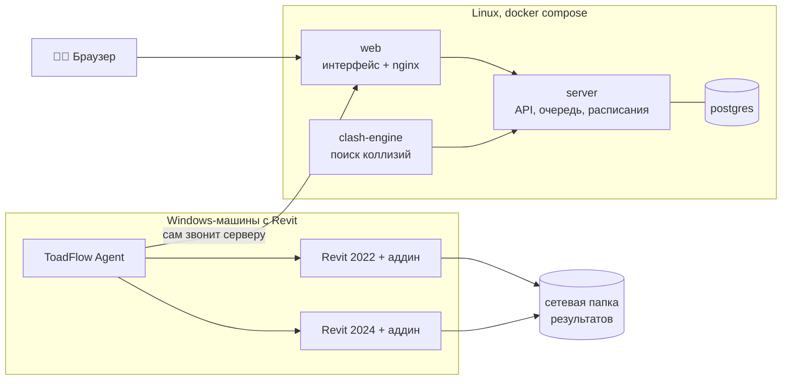

# ToadFlow 🐸

**Ферма Revit, которая работает, пока вы спите.**

В каждой проектной компании есть человек, который по вечерам открывает сорок моделей по очереди, жмёт «Экспорт в NWC» и смотрит на полосу загрузки. ToadFlow придуман, чтобы этот человек пошёл домой.

Вы один раз говорите в браузере: «эти модели, в эту папку, по будням в 20:00». Дальше Windows-машины с Revit сами открывают модели, выгружают, проверяют, ищут коллизии — и докладывают, что получилось. Если Revit завис (а он зависнет), его тихо пристрелят и запустят заново. Вам останется утром посмотреть на зелёные галочки.

## Что умеет

| Модуль | Простыми словами |
|---|---|
| 📦 **Выгрузка RVT / NWC** | Сохраняет модели в RVT и NWC в сетевую папку, откуда их берут смежники и заказчики. Каждый день, без напоминаний |
| ✅ **Проверка LOI** | Проверяет, заполнены ли параметры, по профилям ParamChecker. На каждую модель — отчёт Excel, на все вместе — аналитика: кто молодец, а кто «потом заполню» |
| 💥 **Коллизии** | Ищет пересечения между моделями разделов **без Navisworks**. База коллизий с номерами и статусами, отчёты, рабочие места проектировщиков и панель прямо в Revit |
| 🧩 **Семейства** | Каталог семейств из сетевой папки: поиск по типоразмерам и параметрам, картинки, версии, заявки «сделайте мне такое же, но с перламутровыми пуговицами» |

Любой модуль можно не включать: не нужны коллизии — их просто не будет в меню.

И четыре вещи, на которых всё держится:

- Модель всегда открывается в Revit **своей** версии (2020–2027) и **не обновляется**. Никаких «упс, мы пересохранили вам проект в 2025».
- Одна машина держит несколько Revit сразу, в том числе разных версий. Сколько — решает администратор (и оперативная память).
- Зависший или упавший Revit агент убивает сам, а модель обрабатывается повторно.
- Всё подписано: кто создал расписание, кто его менял, кто запустил выгрузку и кто убил Revit. Анонимных героев не бывает.

## Как это устроено

- **Сервер** — мозг. Хранит расписания, раздаёт задания, собирает пошаговые логи и слепки моделей для коллизий.
- **Движок коллизий** — отдельный контейнер-математик. Берёт у сервера прогоны по одному и молча считает пересечения.
- **Агент** — руки. Сам подключается к серверу, запускает Revit, следит за ним и рассказывает, как идут дела. Открывать порты на машинах с Revit не нужно.
- **Аддин** — то, что работает внутри Revit. Причём только внутри того Revit, который запустил агент. Revit, который проектировщик открыл руками на той же машине, никто не тронет.

Хотите картинку целиком, а не по частям? → [ToadFlow за пять минут](Tour).

## Вам куда?

### 🛠 Я ставлю и обслуживаю

| Шаг | Страница |
|---|---|
| 1. Поднять сервер на Linux | [Установка сервера](Server) |
| 2. Поставить агента на машины с Revit | [Установка агента](Agent) |
| 3. Завести людей, источники и первое расписание | [Первый запуск](Getting-started) |
| Обновиться | [Установка сервера → Обновление](Server#обновление) — свежий переход [с 3.1 на 3.2.0](Server#с-31-на-320-снятие-ошибок-на-обзоре) |
| Что-то сломалось | [Частые проблемы](Troubleshooting) |

### 🎛 Я координатор и рулю процессом

| Что хочу | Страница |
|---|---|
| Понять, что на экране | [Обзор и меню](Dashboard) |
| Настроить выгрузку или проверку | [Расписания](Schedules) |
| Узнать, что случилось ночью | [История и логи](History) |
| Найти, где меняется вот эта настройка | [Где что настраивается](Settings) |
| Проверять заполнение параметров | [Проверка LOI](LOI) → [Профили](LOI-profiles) → [Аналитика](Analytics) |
| Научить ToadFlow читать имена моделей | [Разбор имён моделей](Model-naming) |
| Ловить пересечения | [Коллизии](Clash) |
| Навести порядок в семействах | [Семейства](Families) |

### ✏️ Я проектировщик, мне просто работать

Вам сюда: [Проектировщику](Designer). Одна страница про коллизии, семейства, заявки и уведомления — в браузере и в Revit.

### 🧑‍🔬 Я хочу залезть внутрь

[Разработка](Development) — как собрать, запустить, протестировать и написать свой модуль.

А если встретилось непонятное слово («слепок», «кусок имени», «пространство») — есть [Словарь](Glossary).

## Родственники

ToadFlow — не один в семье. Тяжёлую работу делают ядра, которые живут в своих репозиториях:

- [ToadExport](https://github.com/Alexpivo394/ToadExport) — ядро выгрузки RVT/NWC в виде NuGet-пакетов; тот же код работает в плагине ToadExporter.
- [ToadParamCheck](https://github.com/Alexpivo394/ToadParamCheck) — ядро проверки LOI; тот же код работает в плагине ParamChecker.
- [ToadClash](https://github.com/Alexpivo394/ToadClash) — ядро поиска коллизий: формат слепков, правила, движок, картинки и выгрузка из Revit.
- [ToadFamilyManager](https://github.com/Alexpivo394/ToadFamilyManager) — ядро библиотеки семейств: обход папки, чтение семейства, загрузка в проект и метка на семействе.
- [ToadTools](https://github.com/Alexpivo394/ToadTools) — плагины для Revit, в том числе ToadExporter, ParamChecker и панели «Коллизии» и «Семейства».
